# SRAM Circuit and Layout Design

This repository contains a Cadence SRAM design library with schematic, layout, and symbol views. The design is organized into memory cells, array blocks, read/write peripheral circuits, address decoding, control logic, and supporting sequential and combinational circuits.

Explore the [array and block views](#array-and-block-views), [read/write peripherals](#readwrite-peripheral-views), [decoders](#decoder-views), [flip-flops and multiplexers](#flip-flop-and-multiplexer-views), and [logic gates](#logic-gate-views). The galleries pair the original 128×128 Cadence layout and schematic thumbnails by cell.

## Structural Overview

The `SRAM/` library, packaged in [data/SRAM.zip](data/SRAM.zip), contains 19 cells. The following diagram groups the cells by function.

```text
SRAM Library
├── Memory Cells and Array Blocks
│   ├── SRAM_CELL
│   ├── SRAM_BLOCK16X1
│   └── SRAM_BLOCK16X32
├── Read/Write Peripheral Circuits
│   ├── SRAM_PRECHARGE
│   ├── SRAM_SENSEAMP
│   └── SRAM_WRITEDRIVER
├── Address Decoding and Control
│   ├── DECODER
│   ├── DECODER_D_FF
│   ├── 1_BIT_D_FF_DECODER
│   └── SRAM_BLOCK_CONTROL
├── Data Selection and Sequential Logic
│   ├── 1_BIT_D_FF
│   ├── MUX_TG
│   └── MUX_D_FF_26
├── Logic Gates
│   ├── INVERTER
│   ├── INVERTER_SRAM
│   ├── NAND_5
│   └── 5inputAND
└── Integration and Simulation-Related Blocks
    ├── SRAM_BLOCK
    └── SRAM_BLOCK16X32_SIM
```

## Memory Cells and Array Blocks

`SRAM_CELL` is the basic storage-cell design. Its schematic describes the cell circuit, while its layout provides the corresponding physical implementation. A symbol view supports reuse of the cell in larger schematics.

The library includes array-level designs named `SRAM_BLOCK16X1` and `SRAM_BLOCK16X32`. The `SRAM_BLOCK16X1` schematic preview shows a vertical arrangement of repeated circuit instances. Both blocks include schematic and layout views, providing circuit-level and physical representations of the array designs.

`SRAM_BLOCK` provides an additional SRAM block design with schematic and layout views.

### Array and Block Views

| Cell | Layout | Schematic |
| --- | :---: | :---: |
| `SRAM_BLOCK16X32` | 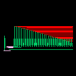 | 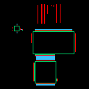 |
| `SRAM_BLOCK16X1` | 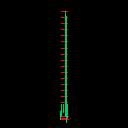 | 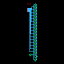 |
| `SRAM_BLOCK` | 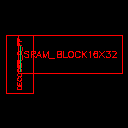 | 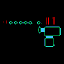 |
| `SRAM_BLOCK_CONTROL` | 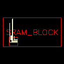 | 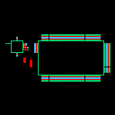 |
| `SRAM_BLOCK16X32_SIM` | 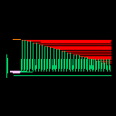 | 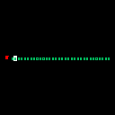 |

## Read/Write Peripheral Circuits

The peripheral cells cover the three main circuit functions associated with accessing an SRAM array.

| Cell | Circuit Function |
| --- | --- |
| `SRAM_PRECHARGE` | Bitline precharge: establishes the initial bitline condition before a read operation. |
| `SRAM_SENSEAMP` | Read sensing: detects and amplifies the signal developed on the bitlines. |
| `SRAM_WRITEDRIVER` | Write driving: applies the data-dependent bitline levels used to update a selected storage cell. |

Each peripheral cell includes schematic, layout, and symbol views, allowing its circuit, physical implementation, and reusable schematic interface to be represented separately.

### Read/Write Peripheral Views

| Cell | Layout | Schematic |
| --- | :---: | :---: |
| `SRAM_PRECHARGE` | 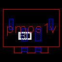 | 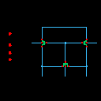 |
| `SRAM_SENSEAMP` | 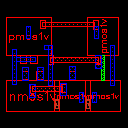 | 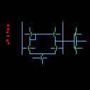 |
| `SRAM_WRITEDRIVER` | 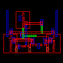 | 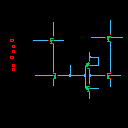 |

## Address Decoding and Control

The address and control group contains `DECODER`, `DECODER_D_FF`, `1_BIT_D_FF_DECODER`, and `SRAM_BLOCK_CONTROL`.

In an SRAM architecture, decoding converts an address into a selection signal for the storage array. Control circuitry coordinates array selection with the read and write peripheral circuits.

| Cell | Design Category | Included Views |
| --- | --- | --- |
| `DECODER` | Address decoding | Schematic, layout, symbol |
| `1_BIT_D_FF_DECODER` | Decoder-related D flip-flop | Schematic, layout, symbol |
| `DECODER_D_FF` | Decoder/flip-flop block | Layout |
| `SRAM_BLOCK_CONTROL` | SRAM block control | Schematic, layout |

### Decoder Views

| Cell | Layout | Schematic |
| --- | :---: | :---: |
| `DECODER` | 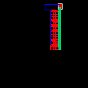 | 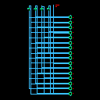 |
| `1_BIT_D_FF_DECODER` | 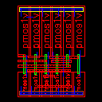 | 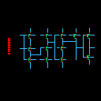 |
| `DECODER_D_FF` | 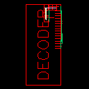 | — |

## Data Selection and Sequential Logic

The library includes flip-flop and multiplexer designs to support signal storage and selection.

| Cell | Design Category |
| --- | --- |
| `1_BIT_D_FF` | Single-bit D flip-flop |
| `MUX_TG` | Transmission-gate multiplexer |
| `MUX_D_FF_26` | Multiplexer/flip-flop block |

All three cells provide schematic, layout, and symbol views.

### Flip-Flop and Multiplexer Views

| Cell | Layout | Schematic |
| --- | :---: | :---: |
| `1_BIT_D_FF` | 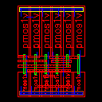 |  |
| `MUX_TG` | 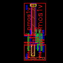 | 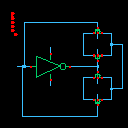 |
| `MUX_D_FF_26` | 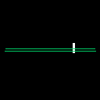 | 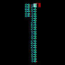 |

## Supporting Logic Gates

The supporting logic cells include two inverter designs, `INVERTER` and `INVERTER_SRAM`, together with `NAND_5` and `5inputAND`.

These cells provide inversion and multi-input logic functions for constructing larger circuits. The inverter cells and `5inputAND` include schematic, layout, and symbol views; `NAND_5` includes schematic and symbol views.

### Logic Gate Views

| Cell | Layout | Schematic |
| --- | :---: | :---: |
| `INVERTER` | 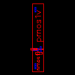 | 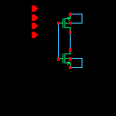 |
| `INVERTER_SRAM` |  |  |
| `5inputAND` | 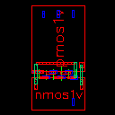 | 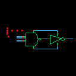 |
| `NAND_5` | — | 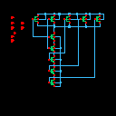 |

## SRAM Access Functions

The main circuit functions can be understood through the standard SRAM access flow:

1. **Selection:** Address decoding selects the storage location to access.
2. **Read preparation:** Precharge circuitry establishes the starting bitline condition.
3. **Read sensing:** The selected cell develops a bitline signal, which the sense amplifier converts into a readable output.
4. **Write driving:** For a write operation, the write driver applies the input data to the bitlines while the target cell is selected.

Flip-flops provide signal storage, multiplexers provide signal selection, and logic gates support decoding and control.

## Simulation-Related Design

`SRAM_BLOCK16X32_SIM` is the simulation-related member of the SRAM block family. It includes schematic, layout, and symbol views alongside the other array and block designs.

## SRAM Cell Detail

### SRAM Cell Views

| Cell | Layout | Schematic |
| --- | :---: | :---: |
| `SRAM_CELL` | 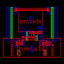 | 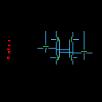 |

The [SRAM_Cell](SRAM_Cell/) directory provides larger schematic and layout images of the storage cell.

| SRAM Cell Schematic | SRAM Cell Layout |
| :---: | :---: |
| 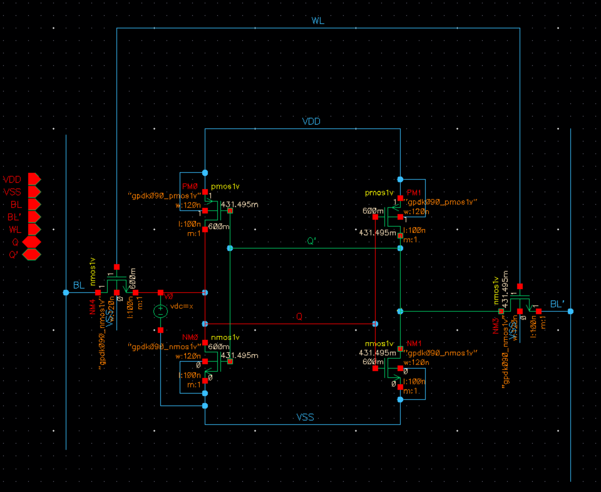 | 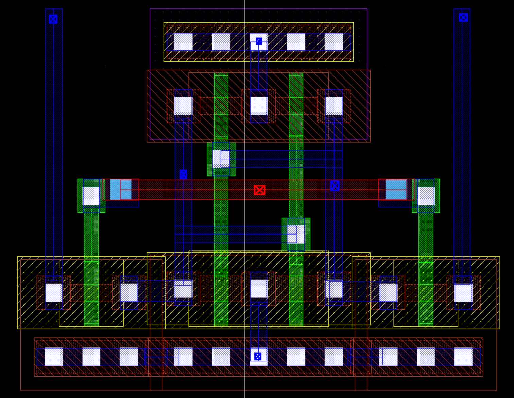 |
